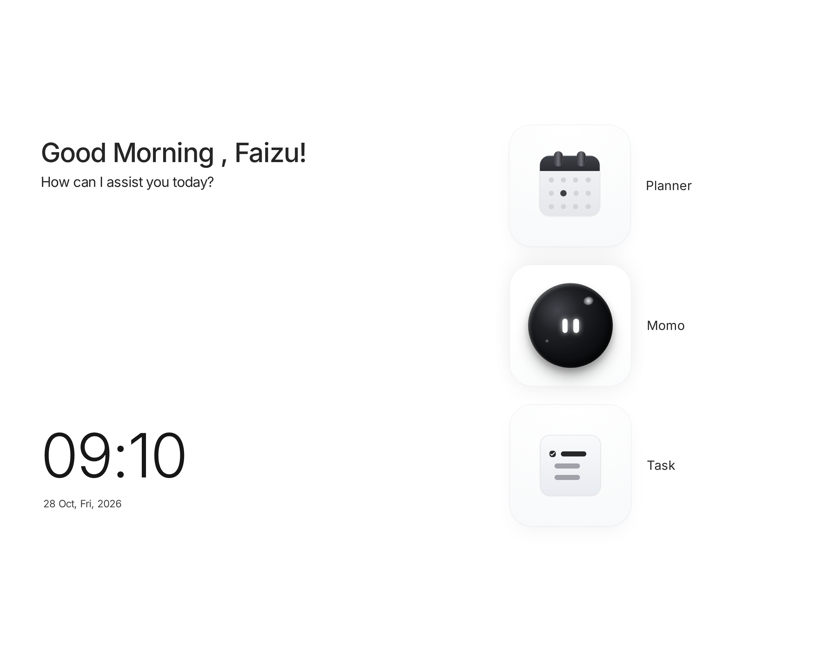
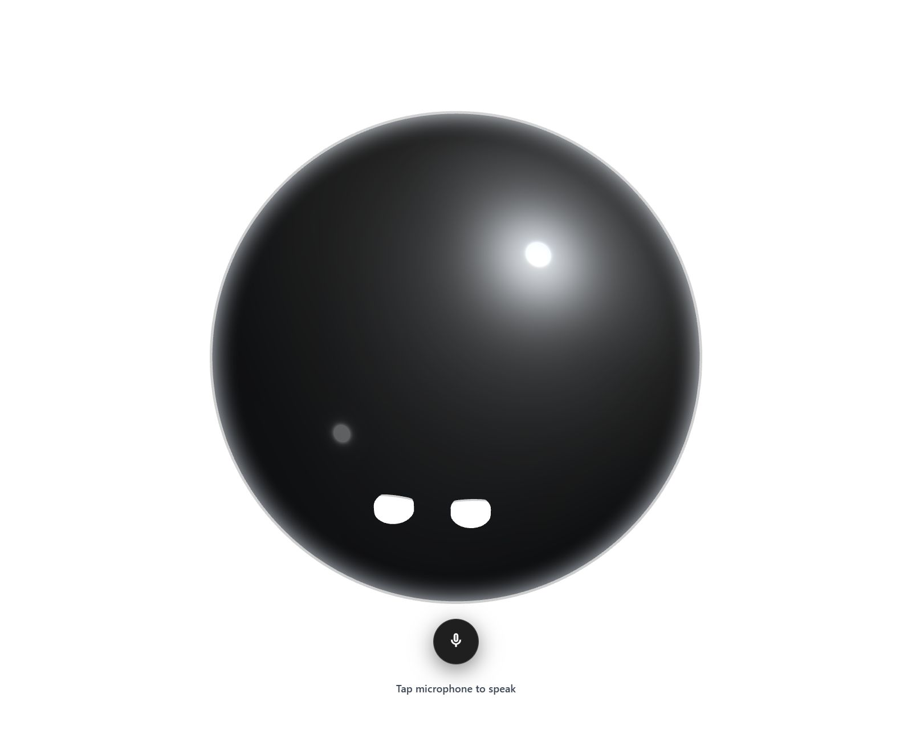
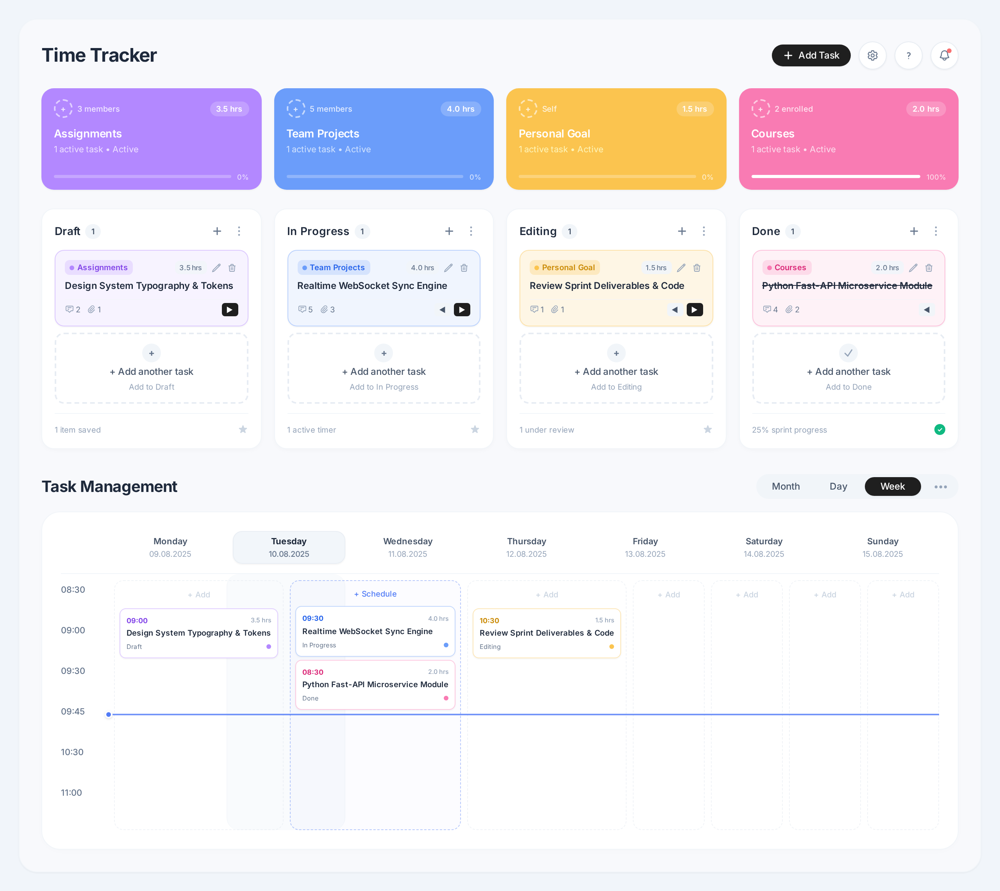
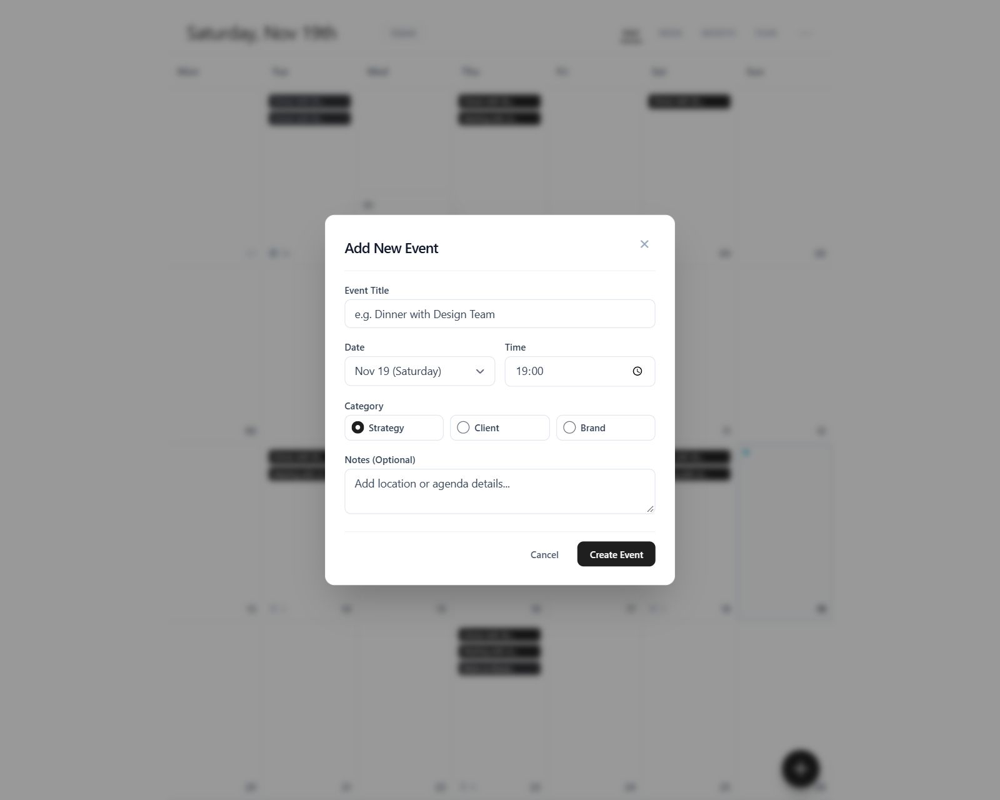

# MOMO - Campus Voice AI Agent Frontend

An interactive, client-ready web frontend and dashboard for **MOMO - Campus Voice AI Agent**. Built with modern frosted neumorphic styling, Three.js 3D sphere visualization, interactive voice states, an agile Task Management & Time Tracker Kanban system, and a comprehensive Calendar Schedule Planner.

---

## 📸 Screen Gallery & Features

| Home Launcher | Voice AI 3D Sphere |
| :---: | :---: |
|  |  |
| **Minimal frosted cards dock & live clock** | **Real-time Three.js sphere with speech states & chat** |

| Time Tracker & Task Board | Calendar Schedule Planner |
| :---: | :---: |
|  |  |
| **Kanban workflow & weekly schedule matrix** | **Day/Week/Month/Year grid with AI conflict optimizer** |

---

## 📁 Project Directory Structure

```text
MOMO-Frontend/
├── index.html                   # Main consolidated Single-Page Application (SPA)
├── README.md                    # Project documentation & client guide
├── .gitignore                   # Standard Git ignore rules
│
├── pages/                       # Standalone modular screens
│   ├── momo-home-launcher.html  # Standalone Home Launcher dock
│   ├── momo-planner.html        # Standalone Calendar Schedule & Planner
│   ├── momo-threejs-sphere.html # Standalone Three.js 3D Sphere & Voice interface
│   └── momo-time-tracker.html   # Standalone Time Tracker & Kanban board
│
├── assets/                      # Media and design deliverables
│   └── screenshots/             # High-resolution design previews & mockups
│       ├── momo-home-launcher.png
│       ├── momo-minimal-header.jpg
│       ├── momo-planner.jpg
│       ├── momo-threejs-sphere.jpg
│       └── momo-time-tracker.png
│
├── components/                  # Reusable UI component library (React/TSX)
│   └── ui/
│       ├── agent-chat.tsx       # Interactive AI chat interface
│       ├── agent-chat-demo.tsx  # Chat demo harness
│       ├── ai-response-writer.tsx
│       ├── demo.tsx
│       ├── scroll-area.tsx      # Custom scroll containers
│       └── separator.tsx
│
└── lib/                         # Shared utilities
    └── utils.ts                 # Class merger & styling helpers (cn utility)
```

---

## 🚀 Key Modules & Architecture

### 1. Main Integrated Application (`index.html`)
- Seamlessly integrates all four modules into a single unified client experience without page reloads:
  - **Launcher Screen**: Displays personalized greeting, live clock/date, and interactive 3D miniature widgets.
  - **Momo Voice Section**: Activates a full-screen Three.js 3D sphere responding to voice states (**Idle**, **Listening**, **Thinking**, **Speaking**), sound waves, and an embedded AgentChat conversation engine.
  - **Time Tracker Section**: Complete task lifecycle dashboard with real-time category cards, multi-stage drag-and-drop Kanban columns (**Draft**, **In Progress**, **Editing**, **Done**), and a weekly time-slot schedule grid.
  - **Calendar Planner Section**: Multi-view schedule (**Day**, **Week**, **Month**, **Year**), day event popovers, quick-add modal, and AI Schedule conflict resolution.

### 2. Standalone Screen Pages (`pages/`)
Each module is also provided as an isolated standalone page with reciprocal navigation to the main application:
- `pages/momo-home-launcher.html`
- `pages/momo-planner.html`
- `pages/momo-threejs-sphere.html`
- `pages/momo-time-tracker.html`

### 3. UI Component Library (`components/ui/`)
- TypeScript + React components structured for seamless porting into Next.js or React frameworks, including `agent-chat.tsx` supporting auto-resizing input, attachment triggers, and streaming indicators.

---

## 🛠️ How to Run Locally

You can serve the project using any standard HTTP static server:

### Using Python:
```bash
python -m http.server 8000
```
Then open:
- **Main Application**: [http://localhost:8000/index.html](http://localhost:8000/index.html)
- **Standalone Pages**: [http://localhost:8000/pages/](http://localhost:8000/pages/)

### Using Node / npx:
```bash
npx serve .
```

---

## 💻 Tech Stack
- **Styling**: Tailwind CSS (with Forms & Container Queries plugins)
- **3D Graphics**: Three.js (WebGL Shader materials, lighting, dynamic mouse tracking, organic floating physics)
- **Icons & Typography**: Google Material Symbols Outlined, Google Fonts (Inter, Playfair Display)
- **Component Design**: shadcn/ui compatible React components (`agent-chat.tsx`, `scroll-area.tsx`)
